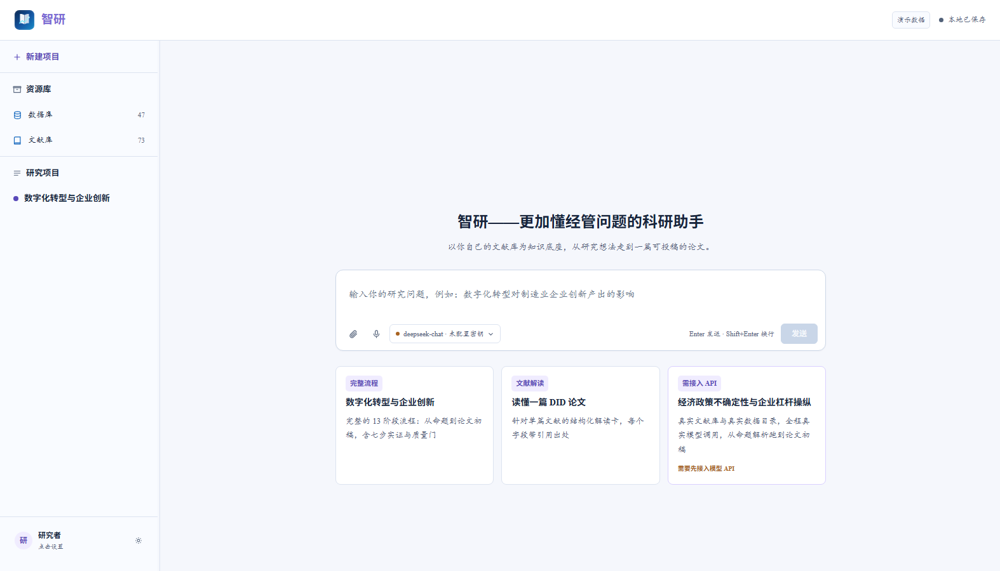

# annaqueen01

## 🚀 作品

<table>
  <tr>
    <td width="46%" valign="top">
      
    </td>
    <td valign="top">
      <h3>智研 · 经管论文研究助手</h3>
      
以你自己的文献库为知识底座，从研究想法走到一篇可投稿的论文。 
      零构建、零后端、可离线运行的纯前端高保真 Demo。

      

        <a href="https://annaqueen01.github.io/zhiyan-demo/"><b>🚀 在线体验</b></a> ·
        <a href="https://github.com/annaqueen01/zhiyan-demo"><b>📦 源码</b></a> ·
        <a href="https://github.com/annaqueen01/zhiyan-demo/tree/main/docs"><b>📄 设计文档</b></a>
      

      

        
        
        
      

    </td>
  </tr>
</table>

> 13 阶段状态机 · 真实中文 BM25 检索（51 篇文献 / 782 页）· OLS + 固定效应 + 七步实证流水线 · 完整设计文档公开
